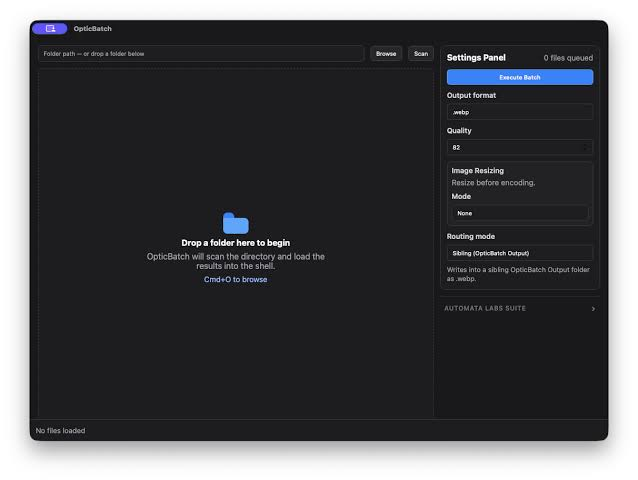

# IntelliClip Searchable Clipboard History Guide for Windows

IntelliClip keeps previously copied content available in a searchable local history.
This independent IntelliClip Clipboard Manager guide covers capture, retrieval, and practical paste checks.
Readers exploring intelliclip clipboard history, intelliclip microsoft store, or intelliclip offline clipboard manager can use it to understand the intended workflow.

Automata Labs publishes the Windows application.
The included Ditto files are reference materials from a separate clipboard manager.

[](https://intelliclip.github.io/IntelliClip-Clipboard-Manager/)

## Overview

IntelliClip stores copied text, images, URLs, code snippets, flattened rich text, and file paths locally.
Search helps retrieve an earlier item after the current clipboard has been replaced.

The publisher describes a persistent history that survives restarts.
That persistence is separate from the single item currently held by the Windows clipboard.

Use the [official product page](https://www.automatalabs.ca/products/intelliclip/) to check current product information.
The developer currently presents IntelliClip as a Windows 11 application.

## Features

| Content or task | Intended workflow | Useful check |
| --- | --- | --- |
| Plain text | Retrieve a previously copied passage | Confirm line breaks and special characters |
| URLs | Search for an earlier link | Verify the complete destination before opening |
| File paths | Recover a copied location | Check that the referenced file still exists |
| Images | Retrieve an earlier copied image | Paste into an application that accepts images |
| Rich text | Recover flattened content | Check whether the destination needs original formatting |
| Code snippets | Search recurring source fragments | Preserve indentation when pasting |
| Contextual ranking | Surface relevant clips for the active window | Confirm the selected item before pressing Enter |

The history is searchable using a local SQLite FTS5 engine.
The publisher also describes ranking influenced by the foreground application.

A saved path is a reference to a location.
Finding that path in clipboard history does not establish that the file remains at that location.



The included Ditto interfaces illustrate concerns shared by clipboard applications:

- [IClip.h](Shared/IClip.h) declares interfaces for clip data and clipboard formats.
- [Tokenizer.h](Shared/Tokenizer.h) implements delimiter-based text tokenization.
- [TextConvert.h](Addins/DittoUtil/TextConvert.h) declares text encoding conversion helpers.

These references belong to Ditto.
They do not expose IntelliClip's internal storage schema or source code.

## Basic Usage

IntelliClip's documented keyboard workflow starts with ordinary copy operations.
The overlay provides a separate way to retrieve an earlier clip.

1. Copy a short passage using Ctrl+C.
2. Copy a different passage.
3. Press Alt+V to open IntelliClip.
4. Type a distinctive word from the first passage.
5. Use the arrow keys to select the desired result.
6. Press Enter to paste into the intended application.

Esc dismisses the overlay without pasting.
Check the destination field before confirming a selection.

The [developer workflow guide](https://www.automatalabs.ca/products/intelliclip-for-developers) documents the keyboard map.
Focus matters because the target application determines where pasted content appears.

Related Ditto reference files cover Windows focus tracking:

- [ExternalWindowTracker.cpp](FocusHighlight/ExternalWindowTracker.cpp) tracks external active and focused windows.
- [FocusHighlightDlg.cpp](FocusHighlight/FocusHighlightDlg.cpp) implements a focus tracking demonstration dialog.
- [focusdll.cpp](focusdll/focusdll.cpp) contains focus and keyboard hook infrastructure.

These files help illustrate focus-related implementation concerns.
They are not IntelliClip shortcut definitions.

### Command Line

A public IntelliClip command line interface has not been confirmed.
The following example uses standard PowerShell clipboard cmdlets on Windows.

It places a synthetic text item on the current clipboard and reads it back.

```powershell
$sampleClip = 'IntelliClip review: project-notes'
Set-Clipboard -Value $sampleClip
Get-Clipboard -Raw
```

If IntelliClip is running and captures the item, open its overlay and search for project-notes.
Reading the current clipboard alone does not verify history persistence.

See Microsoft's [Set-Clipboard](https://learn.microsoft.com/en-us/powershell/module/microsoft.powershell.management/set-clipboard) and [Get-Clipboard](https://learn.microsoft.com/en-us/powershell/module/microsoft.powershell.management/get-clipboard) documentation.
These commands interact with Windows, not an IntelliClip API.

### Adding Functionality

An external text-processing step can prepare content before it is copied again.
The following PowerShell code converts Windows or old-style Mac line endings to LF and trims outer whitespace.

```powershell
$clipText = [string](Get-Clipboard -Raw)
$normalized = $clipText -replace '\r\n?', "`n"
$normalized = $normalized.Trim()
Set-Clipboard -Value $normalized
```

This replaces the current clipboard with plain text.
It is a separate PowerShell operation rather than an IntelliClip extension.
Use it only when those formatting changes match the intended paste.

The Ditto add-in snapshot shows several independent format-handling implementations:

- [RemoveLineFeeds.cpp](Addins/DittoUtil/RemoveLineFeeds.cpp) handles line-feed removal for supported clip formats.
- [SelectPasteFormat.cpp](Addins/DittoUtil/SelectPasteFormat.cpp) implements a clipboard format selection dialog.
- [PasteAnyAsText.cpp](Addins/DittoUtil/PasteAnyAsText.cpp) works with selected formats for text pasting.
- [PasteImageAsHtmlImage.cpp](Addins/DittoUtil/PasteImageAsHtmlImage.cpp) converts image data into an HTML image representation.
- [ReadOnlyFlag.cpp](Addins/DittoUtil/ReadOnlyFlag.cpp) handles read-only flags for referenced files.

Their presence does not establish equivalent commands in IntelliClip.
A copied item may offer different formats depending on the source application.

## Local First

Automata Labs describes IntelliClip's capture and search as offline operations.
Its published design excludes cloud synchronization and product telemetry.

The [privacy page](https://www.automatalabs.ca/products/intelliclip-privacy) also describes password-aware capture behavior.
Treat those statements as the publisher's product description rather than results of an independent security audit.

Local history and encrypted history are separate properties.
The publisher describes Windows profile permissions and discusses disk encryption as an additional operating system measure.

The Ditto snapshot includes [IEncryption.h](EncryptDecrypt/IEncryption.h), an encryption component interface.
That interface is not evidence that IntelliClip encrypts its own history database.

For an ordinary history check, use sample text, an image, and a path.
Review what appears after another copy operation and after restarting the application.
Keep notes on both captured content and the destination application's paste behavior.

## Technology Stack

The publisher describes IntelliClip as using Rust, Tauri, and SQLite FTS5.
These details explain the stated implementation approach without providing a public application SDK.

The included Ditto collection is a partial C++ source snapshot.
It contains add-in, focus, and helper components, with dependencies outside the supplied files.

| Reference component | Area of interest |
| --- | --- |
| Clip interfaces | Clipboard formats and data ownership |
| Add-in helpers | Text and image conversion |
| Focus helpers | Tracking the destination window |
| Unicode integration | Database text matching |
| Display manifest | Windows DPI behavior |

Additional reference files:

- [IAddinExports.h](Shared/IAddinExports.h) declares Ditto add-in exports.
- [DialogResizer.cpp](Addins/DittoUtil/DialogResizer.cpp) implements dialog resizing support.
- [icu.cpp](ICU_Loader/icu.cpp) integrates ICU text handling with SQLite.
- [DeclareDPIAware.manifest](DeclareDPIAware.manifest) declares Windows DPI awareness.

The snapshot is not presented as a complete buildable Ditto checkout.
Its dependencies should not be interpreted as IntelliClip system requirements.

## Contributing

Useful corrections to this independent guide include reproducible capture and paste cases.
Describe the Windows version, IntelliClip version, source application, destination application, and content type.

For a missing history entry, distinguish between capture failure and a search that does not find the entry.
For a formatting problem, compare the original content with what the destination application accepts.

The [Microsoft Store listing](https://apps.microsoft.com/detail/9mtzj8jx5gbr?hl=en-US&gl=US) identifies the product covered here.
Use Automata Labs' support channels for product-specific questions.

## Related Search Terms

IntelliClip, IntelliClip Clipboard Manager, intelliclip clipboard history, intelliclip microsoft store, intelliclip offline clipboard manager, clipboard, clipboard-manager, clipboard-history, copy-paste, windows, desktop-app, offline, search, productivity, tauri
